# Regulation Coordinator 简化设计

本文支撑 [Idea.md](./Idea.md)，是当前唯一的设计辅助入口，不是第二份验收合同。先固定业务实体、观察层级与函数结构，再逐层讨论具体展示与执行语义；不提前定义查询、存储 schema、完整类型或事件清单。

## 1. 不动点与讨论范围

| 方面 | 本轮保留的不动点 | 尚未固定的部分 |
| --- | --- | --- |
| ER 模型 | Objective、Revision、Target、Request、Run、Host 及资源版本、Observation、Fault 的业务边界和关系 | 标识编码、变化事实载荷、物理存储与同步协议 |
| 观察层级 | Objective 与 Host 双主视角；Objective → Target → Request → Run，Host → Run；两者交汇于同一 Run | 具体页面、字段布局、交互和查询实现 |
| 观察内容 | 保留已讨论的 Host、Objective 需求；下文补齐 Target、Request、Run 的候选展示需求 | 新补充部分等待后续逐层讨论，不视为用户已经确认 |
| 函数结构 | 两个意图 Behavior 输入，一个完整状态 Behavior 输出；资源第一参数；两个纯 reducer；副作用在归约之外组合 | 调度策略、生命周期转换、Command/Event 的具体类型 |

此前的详细讨论已移入 [references/](./references/)，仅供追溯，不作为当前实施规范。尤其旧稿中的 Host 内 requestSeq、独立请求确认、共享预算预留、旧 TS 和 SQL，不能因留在参考目录就继续视为已确定设计。

## 2. 业务 ER 模型

[独立放大查看 SVG](./diagrams/entities.svg)



沿用已讨论的统一业务实体关系，不将当前视图或快照成员画成新的业务实体。与最新观察层级对齐：Request 不归属执行 Host，多个 Host 可以同时或先后对同一 Request 产生各自的 Run。图中的 requestRef 只表示稳定请求身份，不选定编码或跨设备分配协议，也不把 Host 局部序号提升为全局身份。

<details>
<summary>Mermaid 图源：业务 ER</summary>

```text
---
config:
  fontFamily: Arial, Helvetica, sans-serif
  themeVariables:
    fontFamily: Arial, Helvetica, sans-serif
    fontSize: 22px
  er:
    minEntityWidth: 280
    entityPadding: 24
    diagramPadding: 24
---
erDiagram
    direction LR
    HOST ||--o{ HOST_BINDING_REVISION : owns
    HOST ||--o{ HOST_RESOURCE_REVISION : configures
    HOST_RESOURCE_REVISION ||--o{ HOST_RESOURCE_BINDING : contains
    HOST_BINDING_REVISION ||--o{ HOST_RESOURCE_BINDING : included_in
    HOST_BINDING_REVISION ||--o{ REGULATION_RUN : used_by
    OBJECTIVE ||--o{ OBJECTIVE_REVISION : versions
    OBJECTIVE ||--o{ REGULATION_TARGET : targets
    OBJECTIVE_REVISION ||--o{ REGULATION_REQUEST : adopted_by
    REGULATION_TARGET ||--o{ REGULATION_REQUEST : receives
    REGULATION_REQUEST ||--o{ REGULATION_RUN : executes
    HOST ||--o{ REGULATION_RUN : hosts
    REGULATION_RUN ||--o{ OBSERVATION : produces
    HOST ||--o{ FAULT : records
    REGULATION_TARGET o|--o{ FAULT : target_scope
    REGULATION_REQUEST o|--o{ FAULT : request_scope
    REGULATION_RUN o|--o{ FAULT : run_scope

    HOST {
        string hostId PK
    }
    HOST_BINDING_REVISION {
        string hostBindingRevisionId PK
        string hostId FK
        string bindingId
        JsonObject configuration
    }
    HOST_RESOURCE_REVISION {
        string resourceRevisionId PK
        string hostId FK
        number appliedAtRevision
    }
    HOST_RESOURCE_BINDING {
        string resourceRevisionId PK,FK
        string hostBindingRevisionId PK,FK
        number capacity
    }
    OBJECTIVE {
        string objectiveKey PK
        string source
    }
    OBJECTIVE_REVISION {
        string objectiveRevisionKey PK
        string objectiveKey FK
        string version
    }
    REGULATION_TARGET {
        string targetKey PK
        string objectiveKey FK
        Subject subject
    }
    REGULATION_REQUEST {
        string requestRef PK "Identity protocol pending"
        string targetKey FK
        string objectiveRevisionKey FK
        string desiredLevel
        number priority
    }
    REGULATION_RUN {
        string runId PK
        string hostId FK
        string requestRef FK
        string hostBindingRevisionId FK
        JsonObject executionLimits
    }
    OBSERVATION {
        string runId FK
        LevelRef current
        string observedAt
        Problem[] problems
        string gapSummary
        Record versions
        Record sources
    }
    FAULT {
        string hostId FK
        string kind
        string message
        string targetKey FK "Optional"
        string requestRef FK "Optional"
        string runId FK "Optional"
    }
```

</details>

### 实体关系的解释边界

- Objective 以规范化 Git 仓库位置和仓库内路径保持稳定身份；ObjectiveRevision 固定完整 commit。定义升级形成新 Revision，不生成新的 Objective 或 Target。来源语法与标识算法后续确定，不在来源中嵌入凭据。
- Target 是一个 Objective 在特定 subject 上的治理对象，不因执行 Host 或定义版本变化而分裂；subject 本身可以限定设备。
- Request 属于一个 Target，固定采用的 Revision、desiredLevel 和 priority；该 Revision 必须属于 Target 的 Objective。外部提出与依赖派生共用 Request 模型；Run 不能绕过 Request。
- 每个 Run 恰好引用一条 Request 和一个执行 Host，通过 Request 推导 Target、版本及目标。同一 Request 可以有零到多个、来自不同 Host 的 Runs；Run 结束不自动代表 Request 已满足。
- Host 是逻辑 worker，不是物理设备、进程或连接。一个 Host 同时至多有一个活动 Coordinator，重启保留身份；Coordinator 自身是守护进程，本地同一系统/profile 通过全程持有 OS 文件锁防止重复实例，不用锁文件存在或更换 hostId 绕过互斥。
- Binding 配置和完整资源配置分别追加不可变版本；capacity 属配置，实际占用由执行事实推导。Run 引用其实际使用的 HostBindingRevision，不能被后续配置改写。executionLimits 是单次 Run 的限制，不在本轮引入共享总预算或预留实体。
- Observation 保存成功观察的内容、时间和来源，经 Run 追溯 Request/Target；Probe 失败不伪造成功观察。Fault 保存发生 Host、种类、详情及必要的下层归属；引用链必须一致，不能因为 Request 跨 Host 执行就要求它归属故障 Host。引用 Run 时仍须匹配执行 Host。
- 业务实体及变化事实只追加；运行阶段、当前资源、最新请求与聚合状态是可重算的视图，不原地改写旧事实。图不穷举变化事实；Observation/Fault 的记录键、同步与归档规则仍待定，不用图中局部键推断跨 Host 全局顺序。

## 3. 函数结构

```text
Coordinator :
  Behavior ResourceAllocation
  -> Behavior RegulationRequests
  -> Behavior CoordinatorState

RegulationRequestsReducer : Command -> RegulationRequests -> RegulationRequests
CoordinatorStateReducer   : Event   -> CoordinatorState   -> CoordinatorState
```

- 外部是有状态、带副作用和执行反馈的二元 Behavior 变换，资源意图是第一参数。不是只读取两个当前值的无记忆逐点函数，也不是简单的 liftM2；输入不变时，Run 反馈、观察和超时仍可改变输出。
- 请求意图表示要尝试推进什么，资源意图表示期望提供什么，输出表示实际已知状态。输入资源的完整值更新不等于实际占用已经变化；最新请求不等于已经启动或完成。
- 两个 reducer 都纯且确定。Command 表达请求意图的 delta，Event 表达状态的 delta；归约不访问现实、不调度、不启动或停止执行。具体 delta 类型待状态转换收敛后推导。
- 调度、runner、持久化等副作用在 reducer 外，通过 monadic composition 组合依赖前一步结果的动作；monadic composition 不等于把整个 Coordinator 称为纯 lift。执行结果成为事实后再归约。
- CoordinatorState 是完整逻辑状态，包含单值状态、集合事实和聚合视图；singleton/collection 不等于现在/历史或权威/派生。视图是可重算表达，不是某次分页 QueryResult；本轮不定义 SELECT。
- 回放不重做副作用；恢复不能把旧意图当新请求重跑。每个 Host 的状态有自己的顺序，跨 Host 汇总不是天然的单一全局序列。持久化、输入接续及跨 Host 协调协议后续确定。

## 4. 观察主视角与层级

| 主视角 | 下钻路径 | 核心问题 |
| --- | --- | --- |
| Objective | Objective → Target → Request → Run | 这个目标定义应用于谁，希望推进到哪里，各次执行作出了什么贡献？ |
| Host | Host → Run，再追溯 Request/Target/Objective | 这个 worker 能做什么、正在做什么、最近发生了什么？ |

Target、Request、Run 是下钻视角，不新增为并列主入口。两个主入口指向同一 Run，不复制执行事实。以下描述关心的信息，不规定页面数量、路由、组件、查询或状态枚举。

### 4.1 Host：逻辑 worker

| 信息组 | 要展示的信息 |
| --- | --- |
| 身份与联系 | 逻辑身份、中央观测的 online/offline/尚未确定；不等同于本地生命周期或是否还有执行 |
| 时间与新鲜度 | 最后联系时间、最后收到状态更新时间、最近业务变更发生时间；三者分开，未知不填假值 |
| 资源与执行能力 | 当前生效配置、bindings/capacity、实际占用与剩余容量；缩容不等于已停止调用，容量差为负不当成可用容量 |
| 当前与近期执行 | 本 Host 的活跃 Runs、近期终结结果，以及它们关联的 Request、Target、Objective；不把共享 Request 当作本 Host 独占任务 |
| 问题与变化 | 需关注的故障、配置与运行变化、证据来源；历史故障不自动是当前故障，失联不自动结束 Run 或释放占用 |

联系和接收时间来自中央观测，业务发生时间来自 Host；不能按不同设备墙钟或消息到达先后伪造业务顺序。没有业务变化不代表 offline，中央自身故障不挂到某个被观察 Host。

### 4.2 Objective：稳定目标定义

| 信息组 | 要展示的信息 |
| --- | --- |
| 身份与定义 | 稳定来源、目标含义、已知定义版本及最新上线版本 |
| 版本采用 | 各 Request 采用的版本，各 Host 活跃 Run 使用的版本，旧版本仍被采用或运行的提示 |
| 应用范围 | subjects 和 Targets，参与推进的 Hosts，可下钻具体 Target |
| 期望与现实 | 各 Target 的目标、已知观察、差距和新鲜度；均按准确 Revision 解释 |
| 活动与问题 | 请求与执行贡献、依赖和故障、发布及治理变化，不预设单一“Objective 已达标”总状态 |

发现 commit 不等于上线。最新上线版本须有发布依据；新建 Request 原则上采用最新上线版本，旧 Request/Run 不被改写。无发布依据、离线或消息滞后时明确未知/已知范围，不静默替换版本或从历史执行推断 Host 落后；离线新建和旧请求替代策略待定。

### 4.3 Target：这个 Objective 应用于这个 subject（候选补充）

| 信息组 | 要展示的信息 |
| --- | --- |
| 对象定位 | 所属 Objective、subject 及其范围，明确不是某台 Host 独有的 Target |
| 治理要求 | 关联 Requests、各自采用版本/目标/priority，以及哪些要求仍在推进；未确定替代规则前不强行合并成唯一有效请求 |
| 已知现实 | 最近 Probe 的时间、结果和来源，成功观察中的 level、problems、gapSummary；区分没有 Probe、失败和旧成功 |
| 执行贡献 | 关联的活跃/近期 Runs 及执行 Hosts，能追溯到准确 Request；并发贡献不自动合成为一次成功 |
| 差距与问题 | 按 Request 的固定 Revision 比较目标与证据，展示相关依赖、故障和新鲜度；不同版本、不同时间的结果不无依据地合并 |

Target 观察的是 subject 上已知现实，不承诺实时状态。最后一次 Probe 失败不显示旧成功为“最新结果”；旧成功是否仍可用须明确标注依据。Probe 先后不能只按晚到消息决定。

### 4.4 Request：一次不可变治理要求（候选补充）

| 信息组 | 要展示的信息 |
| --- | --- |
| 要求与来源 | 稳定请求引用、Target、固定 Revision、desiredLevel、priority，外部提出或依赖派生的来源 |
| 推进情况 | 当前已知的待执行、执行贡献、依赖/阻碍或满足证据；这是信息需求，不在此冻结状态机 |
| 跨 Host 执行 | 同时或先后参与的 Runs、执行 Hosts、各自结果与仍在进行的贡献，不按换 Host 创建另一条 Request |
| 依赖关系 | consumer/provider 要求、为什么需要、当前已知满足情况、共享来源；沿关系下钻，不把 provider 故障复制成 consumer 故障 |
| 时间与证据 | 形成和推进变化、相关观察/问题、最后更新与未知范围；区分调用结束与要求满足 |

展示满足结论时必须可追溯到该 Request 的版本和目标。某 Run 达标、blocked、失败或取消，不能直接替代整个共享 Request 的结论；多个 Run 互相矛盾或缺少协调依据时展示各自事实与未确定部分，不编造全局完成状态。

### 4.5 Run：一次实际执行（候选补充）

| 信息组 | 要展示的信息 |
| --- | --- |
| 启动上下文 | Run 身份、唯一 Request、执行 Host、固定 binding 版本和执行限制；Target/Revision/目标经 Request 追溯 |
| 当前执行 | 当前已知阶段、最近进度及发生/收到时间、实际占用；停止请求、停止中和确认退出分开 |
| 观察与贡献 | 执行中的 Probe、Observation、问题与差距，以及对其 Request 的证据贡献；展示来源和准确版本 |
| 结果与故障 | 已确认的终结结果、时间、原因、故障详情和相关证据；未核实执行不冒充已结束 |
| 过程追溯 | 启动、停止、观察、依赖发现与终结的变化过程；区分真实发生顺序和中央收到顺序 |

pending 请求不伪造 Run。Run 终结不删除历史身份；重连或恢复前的最后已知 running 不等于当前仍存活证明，未确认退出前也不能虚报释放占用。展示配置不得暴露明文凭据。

## 5. 本轮保留的边界与下一步

- 保留资源侧真实授权，不回到 harness grants/ceiling；拒绝与错误明确反馈，不绕过资源边界。
- 仍是有限依赖编排与单次 Run，不扩展为自动维持 level 的长期控制器；不迁移既有服务，不发布 npm 或改设备配置。统一 initial 语义先由 [level-attainment](../../../../01M5EFD1DW5J6MBE9BKCRFW5W3/outer/inner/ideal/Idea.md) 提供，不执行业务检查或回滚。
- 下一步优先逐层复核 Target、Request、Run 的候选观察需求，再由必要事实推导合法转换和 Command/Event。共享 Request 的满足/替代与协调、标识与顺序、资源响应、恢复及存储协议届时讨论，不以旧稿细节填补。
- 本次只整理设计边界；不表示整份 Idea 已验收、类型已定稿或实现已完成。

## 参考资料索引

以下保留原讨论内容及其阶段性矛盾，仅供追溯，以本文为当前阅读入口：

- [原设计原则](./references/Design.md)
- [原 ER 图与说明](./references/Diagrams.md)
- [原类型草案](./references/Types.md)
- [原观察需求与详细查询](./references/Views.md)
- [原事件候选](./references/Events.md)
