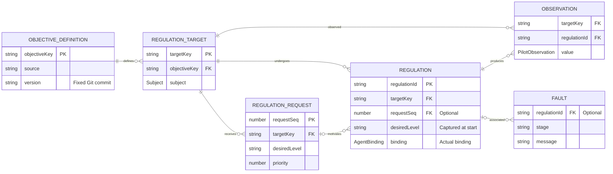
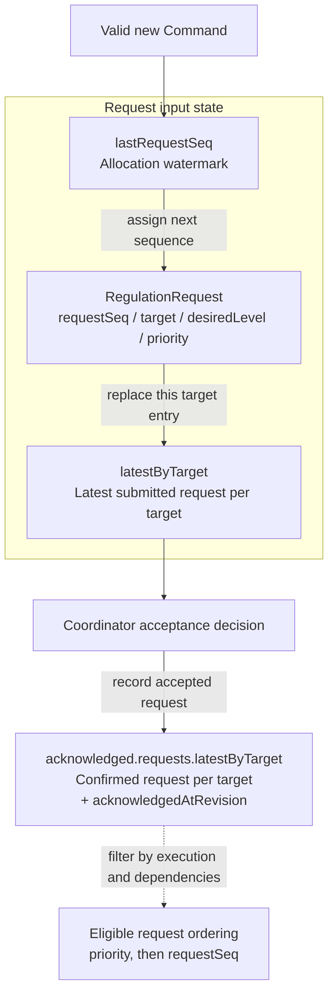
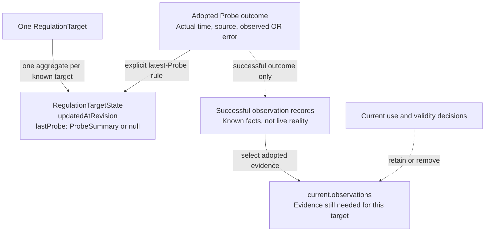
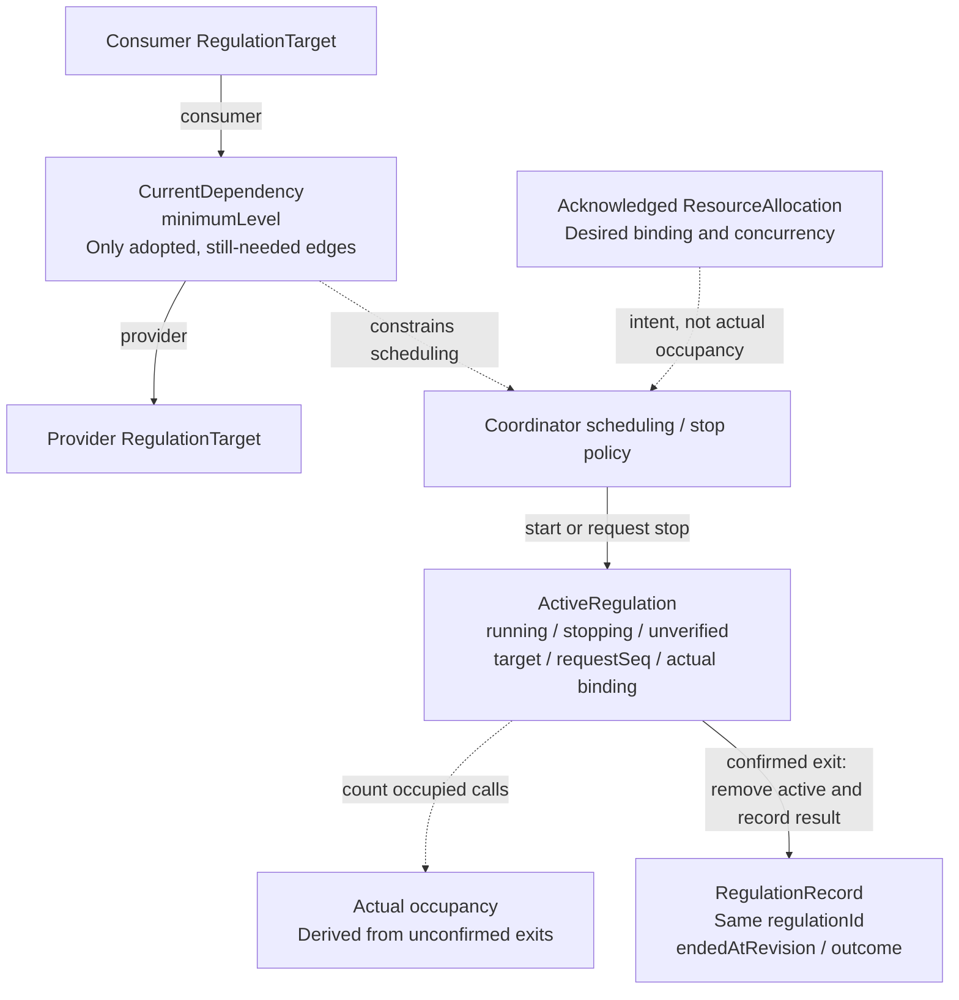
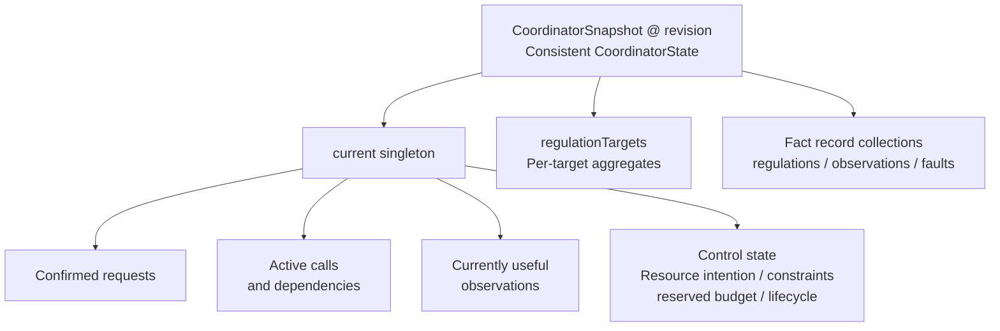

# Coordinator 实体与状态视图

本文支撑 [Types.md](./Types.md) 与 [Design.md](./Design.md)，不是独立合同。五张图依次回答：有哪些业务实体、如何接收和确认请求、如何认识单个治理指向物、如何组织当前执行、如何形成一致快照。不把存储版本归属关系画进业务实体图。

## 分类与阅读约定

| 类别 | 内容 | 含义 |
| --- | --- | --- |
| 业务实体 | ObjectiveDefinition、RegulationTarget、RegulationRequest、Regulation | 具有独立身份；Regulation 是调用，不是请求或 Task |
| 事实记录 | Observation、Fault | 具有发生与来源意义，记录主键仍待确定 |
| 权威聚合或投影 | 已确认请求、Target 状态、当前有效观察 | 由已采纳事实和明确决策维护，不必能从现有实体表随时重算 |
| 派生视图 | 从调用状态选出的活跃集合、实际占用 | 不另设竞争的权威计数；现有 activeRegulations 仍是调用状态的当前存放位置 |
| 业务关系 | 当前采用的依赖 | 不是从所有 target 自动推导，安装/撤销须明确记录 |
| Coordinator 控制状态 | 已确认资源意图、可信约束、累计预留、生命周期 | 不只是调用记录的汇总；预算不能从已裁剪历史简单求和 |
| 一致快照 | CoordinatorSnapshot | 聚合以上状态在一个 Coordinator revision 下的一致版本，不是新的业务实体 |

“视图”是语义分类，不等于 UI 查询结果或可丢弃缓存，也不要求新增数据库 View。查询筛选与分页仍产生派生 QueryResult，不改变权威状态。当前 TS 中的 ActiveRegulation 与 RegulationRecord 是同一 Regulation 在不同生命周期阶段的表达，本次拆图不合并其联合类型或引入第二套执行身份。

图中英文标签与 TS 字段对应，解释使用中文。全部源固定为 22px Arial，SVG 可独立放大查看；修改后须重新生成并验证文字边界。实线表达关系/组成或明确数据流，虚线表达决策输入、选择条件或派生关系；只有第一张 ER 图使用基数符号。

## 1. 业务实体关系

[打开实体关系 SVG](./diagrams/regulation-target.svg)

只画实体身份及关联，不画 coordinatorRevision、快照成员表或当前/历史分组。图的既有文件名保留以兼容旧链接。

- ObjectiveDefinition 的 source/version 共同决定 objectiveKey；targetKey 由该 key 与 subject 身份决定。
- requestSeq 单独标识请求。一个请求可以尚无调用或涉及多次调用；派生调用允许无直接外部请求。
- Observation 是成功观察事实，不把 Probe 失败伪装为成功观察。当前草案的成功观察关联一个来源调用；是否需要其他来源另行讨论。
- Fault 可以关联调用，也可以来自输入、持久化或恢复。Observation/Fault 不虚构主键；图中 FK 表达逻辑来源，不要求永久保留全部历史父行。
- 图不宣称任意请求都能用于任意 target 的调用；关联的 target 必须按执行协议验证。

## 2. 请求与确认视图

[打开请求与确认 SVG](./diagrams/request-state.svg)

最新提交和最新确认是两条不同状态线，确认不等于执行或完成。拒绝须明确反馈且不覆盖已确认请求。图未规定命令/事件的原子消息边界。

requestSeq 表达请求身份与接收先后，lastRequestSeq 是分配水位；acknowledgedAtRevision 只表达 Coordinator 何时确认。重复确认或 Probe 更新不刷新请求排序，批量确认也不合并请求身份。最新映射不等于完整请求历史，覆盖条目不修改原请求。

## 3. 单个 Target 状态视图

[打开 Target 状态 SVG](./diagrams/target-state.svg)

lastProbe 可以为空或失败，不等于“最新成功观察”。当前有效证据也不必等于最近 Probe：最新失败不能被旧成功冒充，但仍有效且有当前用途的旧证据可以按规则保留。

updatedAtRevision 表达聚合最后改变的 Coordinator 版本，recordedAtRevision 表达事实采纳版本，probedAt 表达实际 Probe 时间；三者不互相替代。“最近”的事实顺序不能由晚到消息采纳时间猜测。当前证据选择和对象聚合都需要明确转换规则，不能当成 UI 临时查询。

## 4. 当前执行与依赖视图

[打开当前执行与依赖 SVG](./diagrams/execution-state.svg)

依赖是明确采用的业务关系，不从所有 target 自动生成，须验证无环、最低 level 与未完成请求归属。provider 证据支持 consumer 的新调用，不复活旧调用；详细共享与满足规则仍待定。

ActiveRegulation 和 RegulationRecord 不代表两个业务实体。只有确认真实退出，才原子移除活跃状态并写入终结记录；stopping/unverified 仍保守占用。占用是派生值，资源期望缩减不自动终止调用；图不新建权威 activeCount 或 Task。

## 5. Coordinator 快照组成

[打开快照组成 SVG](./diagrams/coordinator-state.svg)

CoordinatorSnapshot 是完整 CoordinatorState 在某个 revision 的聚合视图，不是新增 TS 类型或另一份权威状态；它包含 current 和 collections，不只表示 singleton 行。CoordinatorCheckpoint 仍是在外层封装请求输入状态与 CoordinatorState，两者不应混为一谈。

快照版本关联同一转换下的状态，updatedAtRevision、acknowledgedAtRevision、endedAtRevision 等记录各自事实版本，跨快照保留原值。记录可结构共享，不要求每版复制；不能把不同 revision 的查询页拼成完整一致快照。

资源确认、可信约束、累计预留与服务生命周期是控制状态，不是从保留的调用历史简单汇总出来的。尤其启动失败也可能预留预算，历史裁剪不应退还预算。当前权威投影、历史事实与消息日志的持久化映射、复合成员键和一致接续留待存储设计，不在业务实体图中重复展开。
