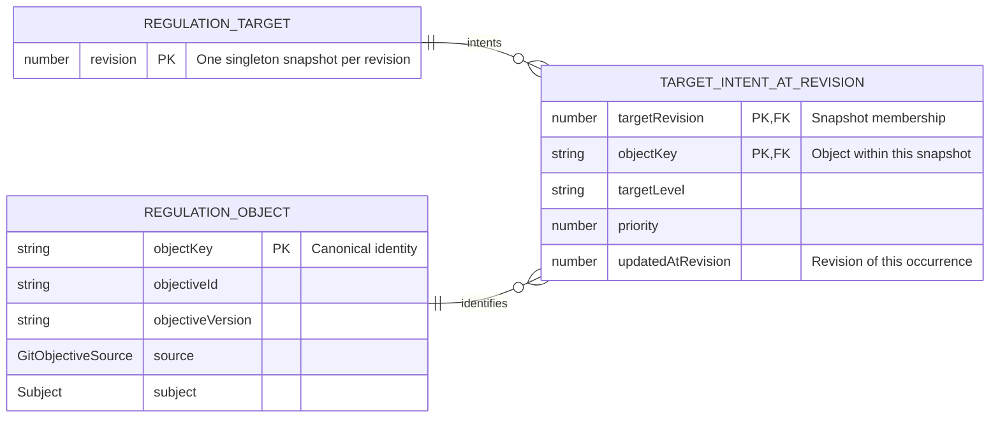
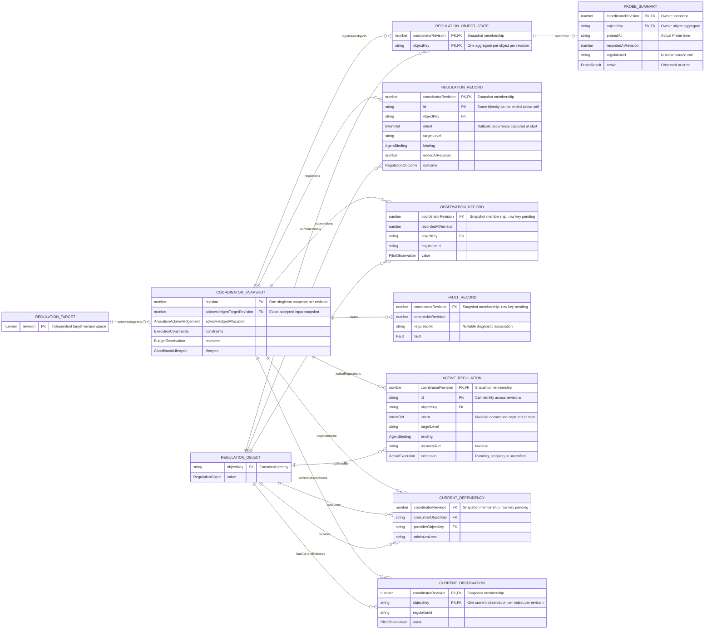

# Regulation Target 与 Coordinator State 模型草案

本文支撑 [Idea.md](./Idea.md) 与 [Design.md](./Design.md)，不是独立验收合同或已发布 API。先分别用 ER 模型讨论 RegulationTarget 和 CoordinatorState，再以 TypeScript 作为补充表达，最后从合法转换推导 Command/Event。旧 [Events.md](./Events.md) 中的分类仅作覆盖检查，不反过来决定状态结构。

## 三个核心类型

- RegulationTarget：治理目标意图的状态；包含多个 Objective/subject 的最新意图及发生修订。
- ResourceAllocation：资源分配意图；binding 与期望并发度整体替换，不表示已经分配或已经停止调用。
- CoordinatorState：Coordinator 的完整领域状态，由 current singleton state 与若干 collection states 组成；集合可以表达历史、实体状态或聚合结果，不包含 Promise、进程句柄或调度器内部对象。

## ER 模型约定

两张图将单个状态实例沿 revision 维度展开，是版本化状态的概念模型，不是物理数据库 schema。singleton 在一个 revision 下恰有一个，跨 revision 则成为以 revision 为 PK 的快照表；current 是选定当前 revision 对应的那一行，不是另一份独立权威状态。Collection 可以在每个 revision 下有零到多条成员记录。`||` 表示一个，`o|` 表示零或一个，`o{` 表示零到多个。

PK 表示模型中的逻辑唯一键，多列标为 PK 表示复合主键；FK 表示版本归属或对象引用。图中的 objectKey 是由精确 Objective 版本、来源和 subject 推导的身份，不要求在 TypeScript 值中重复保存。嵌套值可以展开成实体以说明关系，不意味着新增存储集合。尚未确定的记录键不虚构为 PK；可选字段、联合类型和跨记录约束由图后规则补充。

revision 的唯一性限定在单个状态实例内；两边各有自己的版本空间，不要求编号相等或同步推进。若物理存储混合多个实例，键需额外带宿主提供的实例作用域，不因此把外部 Coordinator ID 加回领域状态。版本化模型也不要求逐版全量复制或永久保留全部快照，可以采用结构共享、增量或快照加日志。

## Regulation Target ER 模型

[独立 SVG：Regulation Target](./diagrams/regulation-target.svg)。在浏览器单独打开可缩放；使用 22px 基础字号和横向布局。SVG 由本节 Mermaid 源生成，模型变化时须同步重新渲染。



- **singleton 沿版本展开。** REGULATION_TARGET 每个 revision 一行，以 revision 为 PK；current 选择其中一个当前版本。TARGET_INTENT_AT_REVISION 是该版本 intents Record 的 ER 表达，以 `(targetRevision, objectKey)` 为复合 PK，一个对象可出现在多个版本中，但每版最多一条。REGULATION_OBJECT 表示对象身份值，不新增第三份独立状态。
- **对象身份决定更新范围。** 同一精确对象的新意图改变新快照中的对应条目，不改写旧快照；不同 Objective 版本、来源或 subject 不能静默合并。targetLevel 和 priority 属于意图，不属于对象身份。
- **快照成员身份与意图发生身份不同。** targetRevision 指定条目属于哪个快照；updatedAtRevision 记录该意图最后发生更新的全局版本。每次合法更新全局 revision 加一并写入条目版本，同值更新也产生新发生身份。IntentRef 仍是 `(objectKey, updatedAtRevision)`，不能用 `(targetRevision, objectKey)` 替代。
- **未变化条目可以跨版本沿用。** A 在版本 5 更新、版本 6 只更新 B 时，快照 6 中 A 的 targetRevision 是 6，updatedAtRevision 仍是 5。updatedAtRevision 必须不大于 targetRevision，不要求等于它；它不是快照成员归属的 FK。
- **只表示期望。** 本图不包含 Regulation、实际资源或执行结果。priority 升序、updatedAtRevision 升序给出意图排序；确认、调度和终结不由本图直接表达。

## Coordinator State ER 模型

[独立 SVG：Coordinator State](./diagrams/coordinator-state.svg)。在浏览器单独打开可缩放；使用 22px 基础字号和横向布局。SVG 由本节 Mermaid 源生成，模型变化时须同步重新渲染。



- **快照行合并整体版本与 singleton 值。** COORDINATOR_SNAPSHOT 以 revision 为 PK，包含该版 singleton 的属性；不再把 COORDINATOR_STATE 和 COORDINATOR_CURRENT 画成两张一对一表。current 选择当前版本的 singleton 行，完整状态还包含该版各个集合。TypeScript 的嵌套 current 只是单版本值的组织形式，不是另一张权威表。
- **集合成员带版本归属。** coordinatorRevision 指向所属快照。对象摘要和当前观察的 PK 是 `(coordinatorRevision, objectKey)`，活跃调用与终结记录的 PK 是 `(coordinatorRevision, id)`；同一对象或调用可以出现在多版快照中，不是在整个版本历史里只能出现一次。依赖、观察和诊断的完整行键仍待推导，coordinatorRevision 不能独自作为这些集合的 PK。
- **成员版本不等于事实发生版本。** endedAtRevision、recordedAtRevision、reportedAtRevision 表示相应事实发生或采纳的版本，不是集合成员归属；例如在版本 10 结束的调用可以仍属于快照 12 的 regulations。不得因属于新快照就重写历史事实版本。
- **输入与执行版本独立。** acknowledgedTargetRevision 引用第一张图中的精确目标快照；多个 Coordinator 快照可以确认同一个目标版本，编号无需相等。它是已确认输入，不保证等于调用方最新目标。
- **状态组织形式与时间范围分开。** regulationObjects 是对象聚合，regulations、observations、faults 示范明细记录，不统一归入 history。regulationObjects 每版每个已知对象最多一条摘要，lastProbe 可为空；同一对象可以关联多次已结束调用和多条观察。REGULATION_OBJECT 是共享身份值，不是额外顶层 Collection，也不要求对象摘要行永久保留。
- **只在真实退出后从活跃转为终结记录。** ACTIVE_REGULATION 与 REGULATION_RECORD 使用相同的调用身份，不能在同一 revision 同时表示同一调用仍活跃且已结束；两者不是新的 Task/Run 双层身份。停止中和未核实调用仍留在活跃集合，真实终结时移除并原子写入结果。
- **关系引用不强制保留历史父行。** observation、Probe 和 fault 中的 regulationId 用于关联来源，不保证对应调用仍在活跃集合；Probe 和 fault 也允许没有来源调用。它们不被画成必须引用某条当前活跃记录的外键。
- **意图发生身份不是当前条目的外键。** IntentRef 引用 objectKey 与启动时的 updatedAtRevision；目标被覆盖后，旧调用仍保留原始引用，不能连到最新意图并冒充新需求的执行结果。acknowledgedTargets 复用第一张图的结构，但不必等于调用方当前的 RegulationTarget。
- **当前依赖是对象之间的关系。** consumer/provider 各自指向一个精确对象，一个对象可参与多条依赖；额外要求无环、最低 level 合法并锚定尚未完成的需求。边的意图归属、共享聚合和唯一键仍待转换设计，不引入历史 Task 节点。
- **对象 Probe 摘要不等于当前成功证据。** lastProbe 包括最近 Probe 的实际时间与成功或失败结果；CURRENT_OBSERVATION 则只保留当前调度仍有效的成功证据。无 Probe、失败、旧反馈和时间顺序规则见下文，最近观察不保证实时现实。
- **图仍是候选，不冒充完整执行协议。** 待处理需求、无调用意图的处理记录、Probe/观察/诊断记录键和恢复接续还未收敛。实体关系明确这些问题的位置，不用 processedIntents 或虚构主键替代转换讨论。

## 完整状态、Singleton State 与 Collection State

CoordinatorState 是领域状态，不是 CoordinatorReadView 或某次查询的结果。current 是一个 singleton state，用单一对象表达 Coordinator 的当前整体状态；其余 collection states 用记录集合表达多个实体、历史明细或聚合结果。singleton/collection 区分的是状态组织形式，不是现在/过去。累计预算和尚未解除的依赖虽然由过去产生，仍影响当前运行；完整终结结果和诊断明细不因此塞进 current。

Collection<T> 表达领域中的记录集合，选用 Collection 而不是 Table 或 Relation，避免暗示 UI 表格、具体数据库或关系代数接口。QueryResult 是对 Collection 按条件筛选、排序、分页后的派生结果，不属于权威状态，也不把某次查询条件写入 Collection 的定义。

下面暂用 readonly T[] 表达 Collection 的逻辑内容，便于讨论纯归约；不规定物理存储、索引、查询 API、分页或保留策略，也不要求把完整集合加载进内存或随 current 一起传输。它不是把分页查询返回的一小段数组冒充完整集合。

正在进行的 Regulation 进入 current.activeRegulations，不再用 Task 包装排队、执行和终结的完整生命周期。调用确认结束时，从活跃集合移除并向 regulations 写入终结记录；同一事件对 singleton 与 collections 的变化须保持一致。UI 可分别读取 current 对象和查询各个 Collection，实时 Stream 本身不提供持久化或历史查询保证。

例如 regulationObjects 是按精确对象身份维护的聚合状态集合，每个对象一条记录，包含它最后一次 Probe 的时间和结果，而不是每次 Probe 都增加一行的历史表。regulations 则示范终结记录集合，两者都是 collection state，不使用 history 分组来限定所有集合的含义。

## TypeScript 补充表达

下面的可独立类型检查代码块表达某一个 revision 下的状态值，补充 ER 模型中的值类型、可选性与联合分支，不替代版本化实体关系。外层 revision 已为嵌套集合提供版本作用域，因此不在每个 TypeScript 条目重复 targetRevision/coordinatorRevision；这不表示集合只有一个全局版本。图中的 ProbeResult 和 ActiveExecution 标签概括对应字段的完整联合类型，不新增协议类型。复用已有协议的对象、观察与 binding 数据类型，不复用旧五命令、资源池或 harness 权限类型。所有别名暂用普通 string/number；合法标识、有限 JSON、非负安全整数、引用完整性等仍需运行时验证，不能因 TS 通过便视为有效输入。

```typescript
import type {
  GitObjectiveSource,
  PilotObservation,
  Subject,
} from "@potential-guide/objective-pilot";
import type { AgentBinding } from "@potential-guide/objective-regulator";

export type Revision = number;
export type ObjectKey = string;
export type RegulationId = string;
export type Collection<T> = readonly T[];

export interface RegulationObject {
  readonly objective: {
    readonly id: string;
    readonly version: string;
    readonly source: GitObjectiveSource;
  };
  readonly subject: Subject;
}

export interface IntentRef {
  readonly objectKey: ObjectKey;
  // 引用 TargetIntent.updatedAtRevision，属于 RegulationTarget 的全局版本空间。
  readonly revision: Revision;
}

export interface TargetIntent {
  readonly object: RegulationObject;
  readonly targetLevel: string;
  readonly priority: number;
  readonly updatedAtRevision: Revision;
}

export interface RegulationTarget {
  readonly revision: Revision;
  readonly intents: Readonly<Partial<Record<ObjectKey, TargetIntent>>>;
}

export type ResourceAllocation =
  | { readonly kind: "no-resource" }
  | {
      readonly kind: "configured";
      readonly binding: AgentBinding;
      readonly concurrency: number;
    };

export interface AllocationAcknowledgement {
  readonly revision: Revision;
  readonly value: ResourceAllocation;
}

export interface Fault {
  readonly stage:
    | "input"
    | "resolve"
    | "start"
    | "execution"
    | "observation"
    | "stop"
    | "release"
    | "persistence"
    | "recovery"
    | "infrastructure";
  readonly message: string;
  readonly regulationId: RegulationId | null;
}

export type ActiveExecution =
  | {
      readonly phase: "running";
    }
  | {
      readonly phase: "stopping";
      readonly reason: string;
    };

export interface RegulationContext {
  readonly id: RegulationId;
  readonly object: RegulationObject;
  readonly intent: IntentRef | null;
  readonly targetLevel: string;
  readonly binding: AgentBinding;
}

export interface ActiveRegulation extends RegulationContext {
  readonly recoveryRef: string | null;
  readonly execution:
    | ActiveExecution
    | {
        readonly phase: "unverified";
        readonly lastKnown: ActiveExecution;
      };
}

export interface CurrentDependency {
  readonly consumer: RegulationObject;
  readonly provider: RegulationObject;
  readonly minimumLevel: string;
}

export interface ObservedObject {
  readonly object: RegulationObject;
  readonly regulationId: RegulationId;
  readonly value: PilotObservation;
}

export type RegulationOutcome =
  | { readonly kind: "target-reached" }
  | { readonly kind: "blocked"; readonly reason: string }
  | {
      readonly kind: "exhausted";
      readonly limit: "time" | "agent-runs" | "stall" | "agent-limit";
    }
  | {
      readonly kind: "cancelled" | "superseded";
      readonly reason: string;
    }
  | { readonly kind: "error"; readonly fault: Fault };

export interface RegulationRecord extends RegulationContext {
  readonly endedAtRevision: Revision;
  readonly outcome: RegulationOutcome;
}

export interface ObservationRecord {
  readonly recordedAtRevision: Revision;
  readonly observation: ObservedObject;
}

export interface FaultRecord {
  readonly reportedAtRevision: Revision;
  readonly fault: Fault;
}

export interface ProbeSummary {
  readonly probedAt: string;
  readonly recordedAtRevision: Revision;
  readonly regulationId: RegulationId | null;
  readonly result:
    | { readonly kind: "observed"; readonly observation: PilotObservation }
    | { readonly kind: "error"; readonly fault: Fault };
}

export interface RegulationObjectState {
  readonly object: RegulationObject;
  readonly lastProbe: ProbeSummary | null;
}

export interface Budget {
  readonly maxStarts: number;
  readonly maxAgentRuns: number;
  readonly maxDurationMs: number;
}

export interface BudgetReservation {
  readonly starts: number;
  readonly agentRuns: number;
  readonly durationMs: number;
}

export interface ExecutionConstraints {
  readonly budget: Budget;
  readonly quota: {
    readonly timeoutMs: number;
    readonly maxAgentRuns: number;
    readonly maxStallRuns: number;
  };
  readonly agentTimeoutMs: number;
}

export type CoordinatorLifecycle =
  | { readonly phase: "recovering" | "open" | "closing" }
  | {
      readonly phase: "closed";
      readonly cleanupFailures: number;
    }
  | {
      readonly phase: "failed";
      readonly fault: Fault;
    };

export interface CoordinatorCurrent {
  readonly acknowledged: {
    readonly targets: RegulationTarget;
    readonly allocation: AllocationAcknowledgement;
  };
  readonly activeRegulations: readonly ActiveRegulation[];
  readonly dependencies: readonly CurrentDependency[];
  readonly observations: readonly ObservedObject[];
  readonly constraints: ExecutionConstraints;
  readonly reserved: BudgetReservation;
  readonly lifecycle: CoordinatorLifecycle;
}

export interface CoordinatorState {
  readonly revision: Revision;
  readonly current: CoordinatorCurrent;
  readonly regulationObjects: Collection<RegulationObjectState>;
  readonly regulations: Collection<RegulationRecord>;
  readonly observations: Collection<ObservationRecord>;
  readonly faults: Collection<FaultRecord>;
}

export type Reducer<Delta, State> = (delta: Delta, state: State) => State;

export type RegulationTargetReducer<Command> =
  Reducer<Command, RegulationTarget>;

export type CoordinatorStateReducer<Event> =
  Reducer<Event, CoordinatorState>;

export interface CoordinatorCheckpoint {
  readonly targets: RegulationTarget;
  readonly coordinator: CoordinatorState;
}
```

## 意图身份与确认

ObjectKey 由精确 Objective 身份、版本、来源与 subject 的规范化语义确定，可对规范化值哈希，具体规则待定；不是任意 regulation ID，也不能直接依赖普通 JSON 属性顺序。intents 是按此 key 索引的只读稀疏 Record，value 保留完整 RegulationObject、targetLevel、priority 与 updatedAtRevision。RegulationObject 不再重复存 key；恢复和输入验证须核对 key 与完整对象一致，并明确哈希碰撞处理，不能静默合并不同对象。

Partial 表达并非每个 ObjectKey 都有条目，索引结果为 TargetIntent | undefined。readonly intents 限制属性重新赋值，Readonly 限制条目的增删替换；这些是编译期约束，不是运行时冻结或递归不可变保证。只将对象自身属性视为意图条目，查询须区分缺失 key 与原型链属性，构造和恢复不能让特殊 key 改变对象原型。

RegulationTarget.revision 是整个意图状态迭代的全局版本号；TargetIntent.updatedAtRevision 表示该对象当前意图最后在哪个全局版本更新。两者共用一个版本空间，不是对象各自递增的两个计数器。

每条合法目标更新按以下规则纯归约：

1. 取 nextRevision = state.revision + 1，不依赖系统时间。
2. 创建新的 Record 对象，在指定 key 上覆盖完整意图，并令 updatedAtRevision = nextRevision；其他条目保持不变，不修改旧 state 或其条目。
3. 返回 revision = nextRevision 的 RegulationTarget。同值新请求也推进版本；非法更新明确报错，不静默消耗版本或更改意图。

例如全局 revision = 8，A.updatedAtRevision = 8、B = 5、C = 7，表示 B 从全局版本 5 起未更新，而非 B 已被修改五次。条目版本是正安全整数且不超过全局版本；版本耗尽须显式失败，不回绕。全局版本作为独立水位保存，不通过当前条目最大值代替；未来即使压缩条目也不能重用旧版本号。

IntentRef 由对象 key 与该条目的 updatedAtRevision 组成，其 revision 引用意图发生时的全局版本，而非随集合更新而改变。CoordinatorState.current.acknowledged.targets 是已确认的目标意图，而 checkpoint.targets 是调用方当前意图，两者允许暂时不同；确认目标不代表创建、启动或完成调用。资源输入本身没有 delta 协议，AllocationAcknowledgement.revision 只是 Coordinator 采纳顺序的元数据，不属于治理意图版本空间。完整状态的 revision 关联 current singleton 与各个 Collection 的一致逻辑版本，不是查询页的位置。

命令关联 ID、非法输入回执、拒绝原因以及是否需要逐对象确认应在转换讨论中补足；不能把遗漏字段解释为允许静默丢弃请求。revision 也不等于底层消息位置，不能用它代替外部输入的可靠接续协议。

## 映射与优先顺序

意图顺序按 priority 升序、updatedAtRevision 升序确定，不依赖 Record 的属性枚举顺序或墙钟时间。同优先级下按最近更新的先后排序，不保留首次加入位置：A(priority 1, revision 10)、B(1, 12)、C(0, 15) 排为 C、A、B；再次更新 A 得到全局版本 16 后排为 C、B、A。仅 priority 更新也刷新逻辑时间，但重新排序不等于无故重启正在运行的调用。

映射加上述排序表达意图的优先队列视图，不是已就绪的实际执行队列。Coordinator 仍须结合当前待处理需求、实际调用和依赖决定可执行项；initial 意图不推进，已终结的同一意图不因扫描或恢复被重新执行。派生需求的有效 priority 与排序关联仍需在 CoordinatorState 的转换讨论中明确。

## 当前调用、意图进度与依赖

ActiveRegulation 只表示已经发起且尚未确认结束的一次调用。intent 非空表示启动时关联的外部意图；派生 provider 可以没有自己的外部意图。object、intent、targetLevel 和 binding 捕获启动事实，后续意图更新不改写旧调用的身份或目标；不再同时维护 TaskId 与 RunId 两套执行身份。

current.activeRegulations 只有 running、stopping 和恢复后尚未核实的 unverified，不含 pending 或 ended。停止请求不移除调用；确认退出后，通过明确的终结事件移除调用、写入 regulations，并原子更新仍影响当前运行的信息。RegulationRecord 保留启动身份、实际 binding 和终结结果，不包含活跃执行状态；达标仍须有效证据支持。启动前撤销、initial 或未产生外部调用的启动失败不伪造一次 Regulation，其意图处理事实的记录类型留待转换设计。启动副作用与持久化之间的故障窗口仍须由恢复协议覆盖，不能因尚未确认启动就漏记可能存在的外部执行。

pending 是尚未执行的当前需求，不预先包装成覆盖完整生命周期的 Task。本稿撤回 processedIntents 这一按对象保存历史处理水位的具体字段，不假定它是当前切片的必需组成。新意图如何进入待处理需求、何时完成或被覆盖、恢复时如何可靠接续，仍须从合法转换推导；不能因为已确认目标仍存在且活跃集合为空，就重新创建需求。历史 Collection 的存在也不自动解决无调用的意图处理记录或输入去重。旧反馈不得完成新意图，有限依赖尚未完成时不得过早结束整个需求；本稿不声称待处理状态类型已经完整。

CurrentDependency 暂以精确 consumer/provider 对象和最低 level 表达仍有效的需求关系，不引用必须永久保存的历史 Task。关系须合法、无环且锚定当前未完成需求；需求覆盖或完成时撤销无用边，共享 provider 仍被引用时保留。blocked 调用已经结束，其完整结果进入 regulations，current 只提取继续编排必需的当前关系和证据。provider 的结果只能支持新的 consumer 调用，不能复活旧调用。边的意图修订归属、真实执行身份、共享聚合和满足条件仍须在转换设计中细化，本类型不是已定案的依赖协议。

## 对象聚合状态

regulationObjects 表达 Coordinator 已知对象的集合，而不是扫描所有可能外部对象的保证。集合内按规范化 Objective/subject 身份唯一；对象进入集合的时机、失去当前需求后是否保留及移除规则仍待转换设计，不能因缺少活跃调用就认定对象不存在。

lastProbe 为 null 表示没有已知 Probe 结果，不伪造时间、成功或 level initial。ProbeSummary 记录实际 Probe 时间、采纳修订、来源调用及结果；probedAt 须由事实提供并验证为 RFC 3339 时间，不在 reducer 中读取系统时钟。最后一次 Probe 失败也须如实表达，不沿用旧成功结果冒充最新结果；当前调度仍需要的成功证据由 current.observations 按自己的有效性规则保留。

“最后一次”必须按明确的 Probe 身份和顺序确定，不按集合枚举顺序、任意生产者时钟或晚到消息的采纳时间猜测；并发、过期反馈和跨重启排序规则仍待推导。recordedAtRevision 只表达采纳顺序，不自动等于实际 Probe 先后。最近一次观察是有时间和来源的已知事实，不承诺对象此刻未发生变化。该聚合由同一事实流确定性更新，不是前端临时查询出来的页面。

## 权威状态与推导值

- ResourceAllocation 的 no-resource 是合法的无资源分配意图，也是输入 Behavior 的初值；不是输入缺失、错误或 dummy binding。configured 表达 binding 与非负安全整数 concurrency，允许 concurrency 为 0 以保留配置。采纳 no-resource 不代表实际调用已停止或占用归零。
- acknowledged.allocation 表达期望，ActiveRegulation.binding 表达实际使用；改变前者不修改后者。确认 concurrency 从 4 变为 2 后，实际占用仍可为 4，停止策略不由这个类型自动规定。
- 实际占用从 running、stopping 和尚未核实的 unverified 调用推导，不另存一个可能漂移的 activeCount。未核实调用在确认退出前保守保留占用。
- current.observations 只保留当前调度或有效依赖仍需要的最新成功观察，不作为所有曾访问对象的缓存；失去当前用途时显式移除，不因此删除 observations 的历史记录或 regulationObjects 中的对象摘要。没有当前条目表示未知，不等于 initial。旧调用和错误 envelope 不可作为当前成功观察写入。
- reserved 是累计权威预留，不能仅从当前调用数重算；启动抛错也可能已经预留。limits 来自可信配置，持久化副本用于核对恢复上下文，不允许快照自行扩充限制。
- current 不以 lastFault 保存最近一次历史诊断；诊断记录进入 faults，输入校验、传输和非终结故障仍须明确对外反馈。持续影响当前运行的故障由相应服务或执行状态表达，服务 failed 可以保留当前故障原因。
- collection states 是权威领域状态的一部分，不是对事件存储的一次查询结果，也不要求复制所有原始消息。实体、聚合及历史都可以用集合表达；消息历史与各个 Collections 的持久化映射、记录键、保留策略及是否还需其他集合，留待具体转换与存储协议确定，查询分页不能改变逻辑集合内容。
- 无 resource ID、capabilities、requirements 或 grants/ceiling。AgentBinding 的配置只能使用可持久化的非秘密数据或安全凭据引用，真实资源自行授权；配额和预算仍独立约束执行。

## 初值、恢复与下一步

新建 RegulationTarget 为 revision 0、intents 为 {}。新建 CoordinatorState 的 revision 为 0，current.acknowledged.targets 同为空，current.acknowledged.allocation 为 { revision: 0, value: { kind: "no-resource" } }；当前活跃调用、依赖和观察为空，reserved 全零、服务 open，可信 constraints 由宿主提供；各个 Collections 均为空。这是已知的初始基线，不声称收到过外部资源更新；后续采纳更新才推进 allocation 修订，初值不启动调用。

CoordinatorState 不含 instanceId 或 inputs。Coordinator 身份由宿主、存储 key 或传输 envelope 关联，不能与调用 RegulationId 混为一谈；是否另需恢复代次由执行协议决定。输入通道的 open/ended/failed、连接与重连属于适配层；通道结束或断开不撤销目标、不把资源意图变为 no-resource，也不自动取消调用或关闭服务。真正影响服务继续运行的故障以明确诊断和相应服务生命周期变化表达。

CoordinatorCheckpoint 仅封装两份领域状态，不固定日志方案或存储格式。需验证对象唯一性、修订与引用一致性及可信约束，不能把任意时刻分别读取的两个 state 拼成“原子快照”，也不能把 current 和来自不同版本的 Collections 拼成一致状态。持久化适配层可以分开存储 singleton 与各个 collections，但须保证共同的逻辑 revision 和原子转换。若采用快照加日志重放，由适配层在外层封装与快照一致的 command/event 处理位置，并负责可靠接续；不预设两个 string | null 字段，也不默认领域 revision 就是日志位置。恢复先还原状态，采用增量回放时只做纯归约，再以 recovering/unverified 核实外部运行，不清空预算、不重放动作、不把同一已终结意图当新请求；格式版本、重关联协议和存储失败行为待实施时明确。

全局 revision 与各条目的 updatedAtRevision 必须一起保存，恢复从保存的全局水位继续。Record 使用普通 JSON 对象表达，无需 Map 专用的 entries 转换；仍须校验所有值可持久化、key 与对象身份一致及版本有效，缺失条目用属性不存在表达，不写入 undefined。具体快照格式仍待确定。

下一步先明确当前待处理需求和输入接续，检查 current 是否足以调度和恢复，并收敛 Collection 记录身份、依赖归属及终结时当前切片与历史写入的原子更新，再列合法状态转换，最后推导 Command/Event。本稿的 string 原因、诊断粒度、恢复字段及数据结构均为讨论选择，不作为最终 API 或已验收决定。
